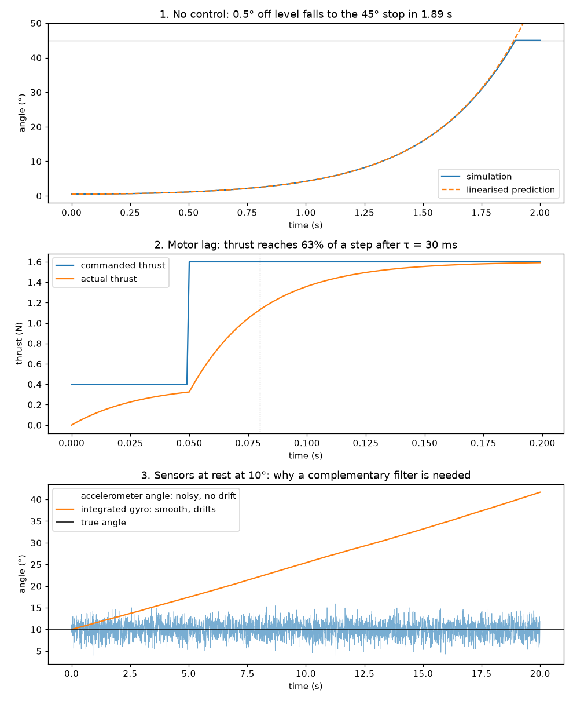
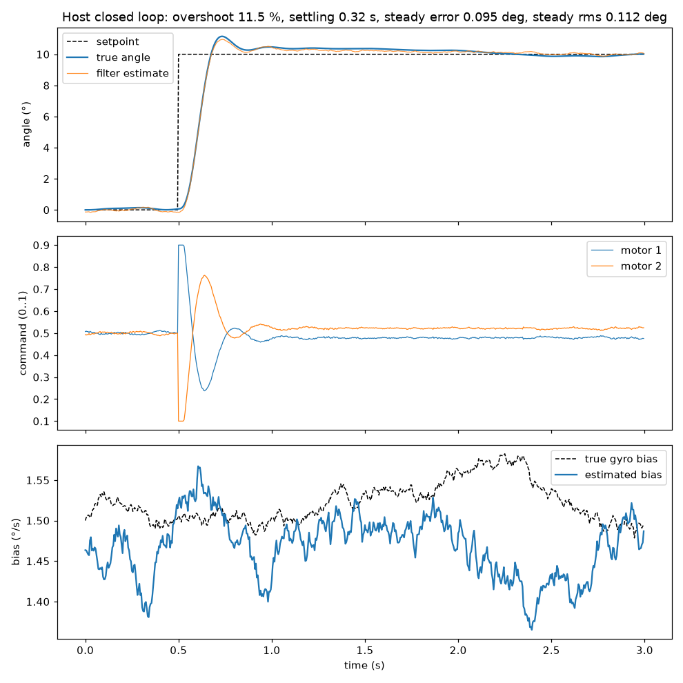

# Bare-Metal-RTOS

Flight-controller-style firmware for an ARM Cortex-M3, built from the reset
vector up and run entirely in emulation (QEMU, ARM MPS2-AN385 board). No vendor
SDK or HAL: startup code, linker script, and drivers are written from scratch.

## Status

| Phase | Scope | Status |
|---|---|---|
| 0 | Toolchain, startup code, linker script, polled UART, CMake, QEMU + GDB | ✅ Done |
| 1 | Full vector table + fault handler, SysTick, interrupt-driven UART with ring buffer, unit tests | ✅ Done |
| 2 | Cooperative scheduler, then FreeRTOS; latency and priority-inversion experiments | 🔄 Cooperative scheduler + FreeRTOS port done |
| 3 | Framed serial protocol (COBS + CRC), Python plant simulation, complementary filter + PID | 🔄 Protocol, link, plant, controller done; firmware integration next |
| 4 | CI, documentation, results | ⬜ |

## Boot sequence

1. On reset the CPU loads the stack pointer from address `0x0` and jumps to the
   address at `0x4`, both from the vector table in `startup.cpp`.
2. `Reset_Handler` copies `.data` from flash to RAM, zeroes `.bss`, and runs
   C++ global constructors (`.init_array`).
3. `main()` creates the FreeRTOS tasks and calls `vTaskStartScheduler()`,
   which programs SysTick, switches to the process stack, and starts the
   highest-priority task. It never returns.

Memory layout (from AN385 Table 3-1), defined in `linker.ld`:

| Region | Address | Size | Holds |
|---|---|---|---|
| Code ("FLASH") | `0x00000000` | 4 MB | vector table, `.text`, `.rodata`, `.data` initial values |
| RAM | `0x20000000` | 4 MB | `.data`, `.bss`, stack (top of RAM, grows down) |
| UART0 | `0x40004000` | | CMSDK APB UART, RX interrupt = IRQ 0 |
| SysTick | `0xE000E010` | | 1 ms kernel tick from the 25 MHz core clock (LOAD = 24999) |

## Interrupts

| Source | Vector | Handler | NVIC priority | Notes |
|---|---|---|---|---|
| HardFault | 3 | `HardFault_Handler` | fixed (−1) | prints faulting PC and fault status registers, halts; reads the frame from MSP or PSP |
| SVCall | 11 | FreeRTOS `vPortSVCHandler` | — | starts the first task |
| PendSV | 14 | FreeRTOS `xPortPendSVHandler` | `0xFF` (least urgent) | context switch |
| SysTick | 15 | FreeRTOS `xPortSysTickHandler` | `0xFF` | kernel tick; calls `vApplicationTickHook()` → `millis()` |
| UART0 RX | 16 (IRQ 0) | `UART0RX_Handler` | `0xC0` | clears flag, pushes byte into a lock-free SPSC ring buffer, notifies `echo_task` |
| everything else | | `Default_Handler` | | weak aliases; override by defining the named handler |

The three FreeRTOS handlers are renamed to our vector table names in
`FreeRTOSConfig.h`, so they override the weak aliases in `startup.cpp`.

**Priority rule:** an ISR that calls a FreeRTOS `...FromISR()` API must have an
NVIC priority numerically ≥ `configMAX_SYSCALL_INTERRUPT_PRIORITY` (`0xA0`).
UART RX runs at `0xC0`. QEMU implements all 8 priority bits (measured by writing
`0xFF` to a priority register and reading it back); real Cortex-M3 parts
usually implement 3 or 4.

RX interrupts are enabled from inside `echo_task`, once the scheduler is
running: never from startup code (the ISR writes `.bss`, which `Reset_Handler`
zeroes after `uart_init()`), and not before `vTaskStartScheduler()` (the ISR
can request a context switch, which needs a running task).

## Scheduling

### FreeRTOS (current)

The firmware runs on FreeRTOS V11.3.2 (`rtos/FreeRTOS-Kernel`, a git
submodule), configured in `app/FreeRTOSConfig.h`: preemptive, 1 kHz tick,
static allocation only (no heap), stack-overflow checking on every context
switch.

| Task | Priority | Wakes on | Job |
|---|---|---|---|
| `echo_task` | 3 | task notification from the UART RX ISR | echo every queued byte |
| `tick_task` | 2 | `xTaskDelayUntil`, every 1000 ms | print `Tick N` |
| `slow_task` (demo) | 1 | `xTaskDelayUntil`, every 100 ms | busy-wait 30 ms |

UART output is serialized by a FreeRTOS mutex (`UartLock`, RAII) so lines from
different tasks don't interleave. Each task has a statically allocated 1 KB
stack; measured high-water marks at `-O0` are 124 B (echo) and 164 B (tick).

**Echo latency** for 120 single characters sent ~8 ms apart, with
`kSlowTaskDemo = true` adding a task that busy-waits 30 ms every 100 ms:

| Scheduler | Slow task | Median | 90th percentile | Max | Echoes > 5 ms |
|---|---|---|---|---|---|
| Cooperative | off | 0.7 ms | 1.4 ms | 2.1 ms | 0 / 120 |
| Cooperative | on | 0.9 ms | 29.2 ms | 63.9 ms | 17 / 120 |
| FreeRTOS | off | 0.3 ms | 0.5 ms | 2.2 ms | 0 / 120 |
| FreeRTOS | on, priority 1 (below echo) | 0.3 ms | 0.5 ms | 2.4 ms | 0 / 120 |
| FreeRTOS | on, priority 4 (above echo) | 0.4 ms | 23.3 ms | 34.7 ms | 12 / 120 |

- Under FreeRTOS, `echo_task` blocks until the ISR notifies it instead of
  polling every 1 ms, so even the unloaded median drops.
- With the slow task below echo, the kernel preempts it the moment a byte
  arrives: latency is unchanged by the 30% CPU hog.
- With the slow task above echo, the stalls return. Preemption only helps a
  task that outranks the work in its way: priority assignment is the design
  decision.

### Cooperative scheduler (Phase 2, step 1)

Before FreeRTOS, `main()` ran a time-triggered cooperative scheduler
(`core/scheduler.hpp`), kept as a unit-tested library: a fixed table of tasks,
each a plain function that runs to completion every `period_ms`.

- **No drift:** a task's next deadline advances by exactly one period, so a
  late run doesn't shift later ones.
- **Overruns:** if a task falls whole periods behind, the missed deadlines are
  counted (`overruns(i)`) and skipped instead of run back-to-back.
- **Wrap-safe:** due checks use the signed difference of 32-bit timestamps, so
  scheduling continues correctly across the 49.7-day `millis()` wrap.
- **Testable:** the scheduler never reads the clock; `run(now)` takes the time
  as an argument, so host tests drive it with a fake clock (including across
  the wrap) in milliseconds of real time.

Its measured limitation (cooperative rows in the table above): bytes still
arrive and are buffered by the ISR, but `echo_task` can't run until `slow_task`
returns, so a task's worst-case start delay is the sum of the other tasks' run
times. That is what moving to a preemptive kernel removed.

## Serial protocol

Binary link between the firmware and the Python plant simulation
(`core/packet.hpp`, mirrored in `sim/protocol.py`):

```
raw packet:  [type][seq][payload 0-32 B][crc_lo][crc_hi]    CRC-16/CCITT-FALSE over type..payload
on the wire: COBS(raw packet) 0x00                          max 38 bytes per frame
```

- **COBS framing:** the encoded frame contains no `0x00`, so `0x00` marks
  frame ends and a receiver resynchronizes at the next one after any error.
  Overhead is fixed at 1 byte per 254.
- **CRC-16/CCITT-FALSE** (poly `0x1021`, init `0xFFFF`, check value
  `0x29B1`): detects all 1- and 2-bit errors, odd bit counts, and bursts up to
  16 bits.
- **Explicit serialization:** fields are written one by one, little-endian,
  floats as IEEE-754 binary32. Structs are never `memcpy`'d onto the wire, so
  padding and byte order can't differ between compilers.
- **`FrameParser`:** byte-at-a-time state machine (collecting / discarding)
  with a counter for each rejection: COBS, length, CRC, type, overflow.

| Type | Direction | Payload |
|---|---|---|
| `Sensor` | plant → firmware | gyro rate (°/s), accel x, accel z (g) |
| `Actuator` | firmware → plant | motor 1, motor 2 |
| `Telemetry` | firmware → host | setpoint, estimate, PID output, loop time (µs) |
| `SetSetpoint` | host → firmware | setpoint (°) |
| `SetGains` | host → firmware | kp, ki, kd |

**Verification:**
- 21 C++ tests: known COBS vectors and max-length runs, the CRC check value,
  every single-bit flip detected, round trips, resync after joining mid-frame,
  overlong frames, and two fuzz tests: 1M random bytes, and 20,000 frames with
  10% corrupted by bit flips, dropped and inserted bytes, in which no corrupted
  packet was ever delivered.
- Fuzz tests also pass under `-fsanitize=undefined,bounds-strict` (checked to
  trap on a deliberately planted buffer overrun).
- Mutation-checked against six planted bugs (wrong CRC polynomial or init,
  missing COBS max-run rule, extra trailing zero, missing length check,
  big-endian fields); all caught.
- **Golden wire bytes** are asserted in both `tests/test_protocol.cpp` and
  `sim/test_protocol.py`, and the same frames built on the Cortex-M3 in QEMU
  match byte for byte. A consistently wrong CRC passes every round-trip test,
  so only fixed external bytes catch it.
- On target (`-Os`) the protocol is ~600 B of flash.

### The UART1 link

UART1 carries the packets; UART0 stays a text console. `SerialPort`
(`platform/mps2_an385/serial_port.*`) is an interrupt-driven driver, one object
per UART, with a 128-byte ring buffer in each direction:

- **RX:** the RX interrupt clears its flag, pushes the byte, and notifies
  `link_task`, which feeds bytes to a `FrameParser`.
- **TX:** `write()` queues bytes and, if the transmitter is idle, sends the
  first one itself. The TX interrupt fires as each byte *finishes* (it doesn't
  fire when enabled while idle, per QEMU's `cmsdk-apb-uart.c`), and sends the
  next. `tx_busy_` is set **before** the `DATA` write because QEMU completes
  the byte, and raises the interrupt, inside that store; the kick runs with
  interrupts masked so the ISR can't interleave with it.

`link_task` (priority 4) currently loops every valid packet back.
`sim/link_test.py` checks the full path against the firmware in QEMU:

```
[round trips] sent 500, echoed 500, mismatches 0, timeouts 0
              latency ms: median 4.03, p99 8.36, max 55.13
[corruption]  sent 347 valid + 153 corrupted; echoed 347, corrupted accepted 0, valid missing 0
firmware:     link ok=847 crc=43 cobs=110 len=0 type=0 ovf=0 rxdrop=0
```

**Link throughput is limited by QEMU, not the firmware.** Round-trip time
grows ~100 µs per byte (10-byte frames 2.1 ms, 22-byte frames 3.7–4.6 ms), with
or without `-icount`, and identical for `-O0` and `-Os` firmware: QEMU moves
bytes between the socket and the emulated UART one at a time. A sensor +
actuator exchange (18 B + 14 B) therefore takes ~3 ms, capping a lockstep
control loop at ~200–300 Hz in emulation. A real UART at 115200 baud costs
87 µs per byte, so the limit is realistic; flight controllers use faster links
or SPI for this.

## Plant model

`sim/plant.py` simulates the thing being controlled: a 1-axis pitch "seesaw"
test stand, a bar on a pivot with a motor at each end, like one axis of a
quadcopter. Pure Python, integrated with RK4 at ≤1 ms substeps.

```
J θ'' = L (T1 − T2) + m g h sin θ − b θ'        T' = (u · Tmax − T) / τ   per motor
```

| Parameter | Value | |
|---|---|---|
| Inertia J | 0.01 kg m² | |
| Arm L | 0.2 m | motor 1 at +L, motor 2 at −L |
| Max thrust | 2 N per motor | command u ∈ [0, 1] |
| Centre of mass above pivot h | 2 cm | makes level **unstable**: a tilt grows e-fold every 0.37 s |
| Damping b | 0.01 N m s/rad | |
| Motor time constant τ | 30 ms | |
| End stops | ±45° | |

Sensors model an IMU on the pivot: the gyro reads rate + bias (1.5 °/s,
random-walking at 0.05 °/s/√s) + 0.3 °/s noise; the accelerometer reads
(sin θ, cos θ) g + 0.03 g noise per axis.



`python sim/open_loop.py` regenerates the figure:
1. Released 0.5° off level with hover thrust, the bar falls to the 45° stop in
   1.89 s, within 0.001° of the linearised two-mode solution up to 5°.
2. Thrust reaches 63.2% of a command step after one 30 ms time constant.
3. Held at 10°, the accelerometer angle averages 9.99° but scatters ±1.7°
   (1σ), while the integrated gyro is smooth but drifts 31.6° in 20 s. The
   complementary filter in the next step fuses them.

`sim/test_plant.py` (14 tests) checks the model against hand-derived physics:
the equilibrium, sign convention, growth rate (to 0.1%) and the characteristic
equation, constant-torque motion, the motor lag, damping decay, end stops,
command clamping, step-size independence, and the sensor noise, bias and
random-walk statistics.

## Attitude controller

`core/attitude_controller.hpp` turns IMU samples into motor commands; the host
tests and (next) the firmware run the same class.

```
gyro, accel → complementary filter → angle, rate → PID → diff → motor1 = hover + diff, motor2 = hover − diff
```

- **Complementary filter** (`core/complementary_filter.hpp`): integrates the
  gyro for fast motion and pulls toward the accelerometer angle for slow motion
  (τ = 0.5 s). A plain filter settles bias × τ = 0.75° off, so it also
  estimates the gyro bias from the persistent gyro/accelerometer disagreement.
  A **startup calibration** (averaging 0.5 s of samples while held still, as
  flight controllers do at power-on) seeds the bias and angle; without it the
  bias estimate took ~5 s to converge.
- **PID** (`core/pid.hpp`): derivative on the measurement, taken directly from
  the bias-corrected gyro (no derivative kick, no differentiated noise); output
  limits; anti-windup by conditional integration; **integral separation**
  (integrate only within 2° of the setpoint); integral stored as its output
  contribution so gain changes don't bump the output.
- **Gains from a model, not trial and error:** with diff → 4584 °/s² and the
  plant's damping and gravity terms, natural frequency 15 rad/s and damping
  ratio 0.8 give kp = 0.051, kd = 0.0050; ki = kp / 1 s.



**Requirements** (set before tuning) and results for a 10° step at 200 Hz with
the default gyro bias and sensor noise:

| | Requirement | Result |
|---|---|---|
| Overshoot | < 15 % | 11.5 % |
| Settling (±0.5°) | < 1 s | 0.32 s |
| Steady-state error | < 0.2° | 0.055° |

How the controller got there (each step visible in `tests/test_control.cpp`):

| Change | Overshoot | Settling | Cause it fixed |
|---|---|---|---|
| Initial design | 13 % | 2.45 s | bias estimate took ~5 s to converge from a single noisy start sample |
| + startup calibration | 18 % | 1.27 s | integral charged during the climb, then unwound slowly (gravity needs the opposite sign at 10°) |
| + integral separation (2°) | 11.5 % | 0.32 s | |

A 30° step overshoots ~16 % whether or not the integral term exists: the
motors saturate for ~245 ms and can't brake in time. That is an actuator
limit (setpoint rate limiting would address it), so the test checks that the
integral adds no overshoot of its own rather than an absolute bound.

**Host closed-loop tests** (`tests/test_control.cpp`, 21 tests) run the
controller against `tests/sim_plant.hpp`, a C++ port of `sim/plant.py` pinned
to it by reference values from the Python model. They cover the filter
(calibration, bias × τ offset without estimation, offset removal, lag-free
tracking), each PID behaviour, and closed-loop cases: the step requirements,
recovery from 8° of tilt, a 10 % weaker motor (removed by the integral; PD alone
leaves > 0.5°), no calibration and no bias estimation (> 0.5° off), a
saturating step, and stability at 100 Hz. Mutation-checked: a wrong-sign D
term, removed anti-windup, a wrong-way bias update and swapped motors are all
caught (the anti-windup test was rewritten after its first version missed it).
`python sim/plot_closed_loop.py` regenerates the figure.

On the Cortex-M3 (no FPU, `-Os`) the controller with software floating point
and `atanf` is ~4 KB of flash. It calls `atan2f` via `__builtin_atan2f`:
GCC 15 refuses `<cmath>` (and C++ `<math.h>`, which wraps it) under
`-ffreestanding`, and the firmware must link newlib's libm.

## Layout

```
app/                    application: tasks (main.cpp), FreeRTOSConfig.h, kernel hooks
core/                   hardware-independent code (ring buffer, scheduler, COBS, CRC-16,
                        packets, frame parser, complementary filter, PID, attitude
                        controller), unit-tested on the host
sim/                    Python side: protocol mirror, plant model, open-loop experiments,
                        UART1 loopback test, and their tests
docs/img/               figures generated by the sim/ scripts
rtos/FreeRTOS-Kernel/   FreeRTOS kernel, git submodule pinned to V11.3.2
platform/mps2_an385/    board-specific: startup, linker script, console UART, interrupt-driven
                        SerialPort, SysTick, NVIC, critical sections, fault handler
tests/                  GoogleTest unit tests for core/, C++ plant port, closed-loop harness
                        and the closed_loop_sim tool
cmake/                  arm-none-eabi toolchain file
scripts/                QEMU launch script
```

## Build and run

Requires the Arm GNU Toolchain (`arm-none-eabi-*`), CMake 3.20+, Ninja, and
QEMU (`qemu-system-arm`) on `PATH`.

Clone with the FreeRTOS submodule (`git clone --recursive ...`), or after a
plain clone run `git submodule update --init`.

```powershell
cmake --preset arm              # configure (once)
cmake --build --preset arm      # build -> build-arm/fw.elf, prints flash/RAM usage
.\scripts\run_qemu.ps1          # run; exit with Ctrl+A then X
python sim/link_test.py         # in a second terminal: UART1 loopback test (TCP 5560)
```

Expected output: a `Tick N` line every second, and anything you type is echoed
back by the firmware.

```
R
Hello from main
Tick 1
Tick 2
```

## Unit tests

Hardware-independent code in `core/` is tested on the host with GoogleTest
(downloaded automatically by CMake). Requires a host `g++` on `PATH`.

```powershell
cmake --preset native           # configure (once)
cmake --build --preset native   # build tests
ctest --preset native           # run
python -m unittest discover -s sim   # Python protocol + plant tests (standard library only)
```

Plotting scripts need matplotlib: `python -m pip install -r sim/requirements.txt`.

## Debug

```powershell
.\scripts\run_qemu.ps1 -Debug                                  # terminal 1: paused at reset
arm-none-eabi-gdb build-arm/fw.elf -ex "target remote :1234"   # terminal 2
```

A fault prints a report and halts, for example after reading an unmapped address:

```
*** HardFault ***
 PC    = 0x00000858
 CFSR  = 0x00008200      <- BFARVALID + PRECISERR: precise bus fault
 HFSR  = 0x40000000      <- FORCED: escalated to HardFault
 BFAR  = 0xfffffff0      <- the address that was accessed
```

Resolve the PC to a source line with
`arm-none-eabi-addr2line -e build-arm/fw.elf -f -C 0x00000858`.

## Memory usage

Flash = `.isr_vector` + `.text` + `.data`; RAM = `.data` + `.bss`, plus an 8 KB
main stack reserved by `linker.ld`. Measured with `arm-none-eabi-size -A`.

| Milestone | Build | Flash | RAM (globals) | Notes |
|---|---|---|---|---|
| Phase 0 | Debug (`-O0`) | 344 B | 0 B | startup + polled UART |
| Phase 1 | Debug (`-O0`) | 2,460 B | 96 B | + SysTick, IRQ-driven RX, ring buffer, fault handler |
| Phase 1 | Release (`-O3`) | 1,716 B | 96 B | |
| Phase 1 | MinSizeRel (`-Os`) | 1,124 B | 96 B | |
| Phase 2: cooperative scheduler | Debug (`-O0`) | 2,948 B | 184 B | + 84 B scheduler table (4 tasks) |
| Phase 2: FreeRTOS | Debug (`-O0`) | 19,508 B | 4,332 B | kernel ≈ 16 KB flash; 3 × 1 KB task stacks + TCBs, idle task, mutex |
| Phase 3: UART1 link | Debug (`-O0`) | 23,248 B | 5,844 B | + link task stack, FrameParser, SerialPort buffers |

`uart1_port` lands in `.data`, not `.bss`: its base address is non-zero, so the
whole object (296 B, mostly its two ring buffers) has an initial image in flash
that `Reset_Handler` copies. Keeping the configuration outside the object would
move the buffers back to `.bss`.

Phase 1 RAM breakdown (from `build-arm/fw.map` / `arm-none-eabi-nm -S`): UART RX
ring buffer 72 B (64 data + two 4-byte indices), RX drop counter 4 B,
`millis` counter 4 B, `millis64` counter 8 B, plus 8 B of alignment padding.

Observations:
- At `-O0`, `RingBuffer::push`/`pop` are ~320 B each because every
  `std::atomic` access is an out-of-line call; at `-O2`+ they inline to a few
  instructions with `dmb` barriers.
- `-O3` unrolls `uart_put_u32`'s digit loop (146 B → 408 B). `-Os` is the
  usual firmware choice when flash is tight.

## QEMU caveats

Measured differences between the emulator and real hardware:
- **Timing:** without `-icount shift=auto` (set in `scripts/run_qemu.ps1`), QEMU
  on Windows can't deliver a 1 kHz SysTick on time, and the firmware clock runs
  ~45% slow. icount ties emulated time to instructions executed instead.
- **UART RX can't overrun:** QEMU holds the next byte until firmware reads
  `DATA`, so a 208-byte burst into a 64-slot buffer loses nothing. A real UART
  at 115200 baud delivers a byte every ~87 µs regardless; a slow ISR overruns
  (STATE bit 3) and a slow consumer fills the ring buffer (`uart_rx_dropped_count()`).
